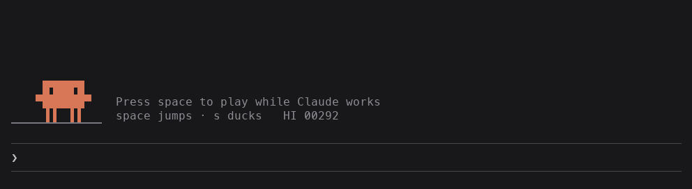

# Clawd Run

**The Chrome dino game, played by Clawd, right above your Claude Code prompt — while Claude works.**



<sub>Rendered from the game's own drawing code, with an autopilot at the keys.</sub>

Clawd Run is a mod for [Claude Code](https://claude.com/claude-code). Whenever Claude is working on something, Clawd shows up in the band above the prompt. Press space and he's off: jumping cacti, ducking birds, getting faster. When Claude finishes, the corner flips from **✻ Claude is working** to **✓ Claude is done**, so you can finish your run or get back to work.

## Install

In Claude Code, in a terminal, type:

```
/plugin install clawd-run --marketplace tomas-schmieder/clawd-run
```

Answer `y` to add the marketplace, then pick a scope (**user** puts it in every session). Or from a shell:

```sh
claude plugin marketplace add tomas-schmieder/clawd-run
claude plugin install clawd-run@clawd-mods
```

Mods (plugins of function hooks) are an early-access Claude Code feature; Clawd Run was built on Claude Code 2.1.293.

## Play

Clawd appears whenever Claude is working. With the prompt box empty:

| Key | Does |
| --- | --- |
| <kbd>space</kbd> | start, jump, restart, resume |
| <kbd>s</kbd> or <kbd>j</kbd> | duck (mid-jump: drop fast) |
| <kbd>p</kbd> | pause / resume |
| anything else | pauses the game and types as usual, so you never type and play at once |

The **[ Pause ]** button in the corner pauses too, and resuming counts down 3-2-1 first. Click the game to hand it the keyboard and the arrow keys work as well; <kbd>Esc</kbd> gives the keyboard back to the prompt. (From the prompt itself the arrows walk your history and <kbd>Esc</kbd> interrupts Claude, so the game leaves them alone.)

- `/clawd-run` opens the game any time, even while Claude is idle.
- `/clawd-run off` stops it showing up while Claude works; `/clawd-run on` brings it back.
- A run keeps going after Claude finishes; the band closes a few seconds after you crash.
- It needs 9 rows above the prompt and at least 40 columns.

Obstacles are random every run, as in Chrome: cacti in groups of up to three, and from about 40 seconds in, birds at three heights: jump the low ones, duck the middle ones, and don't jump into the high ones. Your best score is kept between sessions.

## How it works

- **The band.** An `AbovePrompt` render hook draws a `Client`: a small module that runs on the terminal's own frame clock (about 30 fps) and draws every frame itself.
- **Half-cell pixels.** Each terminal cell holds 2×2 pixels, painted with the quadrant block glyph that matches (`▘ ▝ ▀ ▖ ▌ … █`). That makes Clawd the Claude Code logo pixel for pixel, lets everything move in half-cell steps, and makes collisions exact: a crash is two sprites sharing a pixel.
- **Keys from the prompt.** A `prompt.edit` hook takes space, s and p from the empty prompt box (the box stays empty), counts them into session state, and the band hands the counts to the game. The game posts back how the run is going, so the band stays open until your run is over.
- **Chrome's rules.** Physics, spawning and scoring follow Chromium's dino: the same pace ramp (6 → 13), gap formula, no-three-in-a-row rule, birds from pace 8.5, and 0.025 points per pixel. The ground runs at ¾ speed for the terminal, and since terminals have no key-up, every jump is a full one and the gaps are a little wider to match.

## Development

```sh
claude plugin validate .
claude plugin test .     # includes an autopilot that survives 40 three-minute runs, at every pace
claude --plugin-dir .    # a session running your working copy
```

| File | What |
| --- | --- |
| `hooks/register.tsx` | the hooks: band, prompt keys, `/clawd-run`, scores |
| `hooks/game.tsx` | the `Client`: the loop, input and drawing on the terminal |
| `hooks/clawd.ts` | the game: sprites, physics, spawning, collisions, rasterizing |
| `hooks/keys.ts` | which key does what |
| `types/index.d.ts` | the shared types and the session state's contract |

## Credits

- Gameplay adapted from Chromium's offline T-Rex game (© 2014 The Chromium Authors), via [wayou/t-rex-runner](https://github.com/wayou/t-rex-runner), both under BSD-style licenses; see [NOTICE](NOTICE).
- Clawd is the Claude Code mascot. This is an unofficial fan mod, not affiliated with or endorsed by Anthropic.

## License

[BSD-3-Clause](LICENSE)
